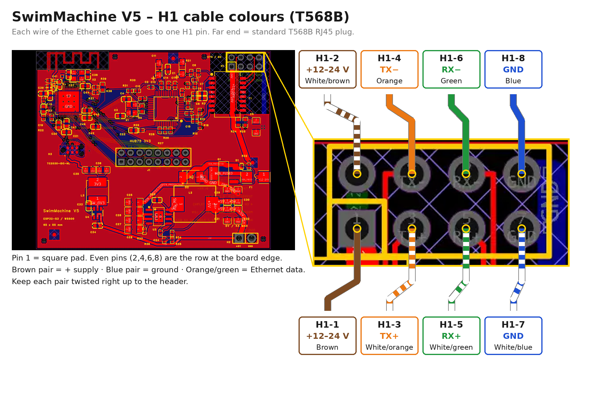
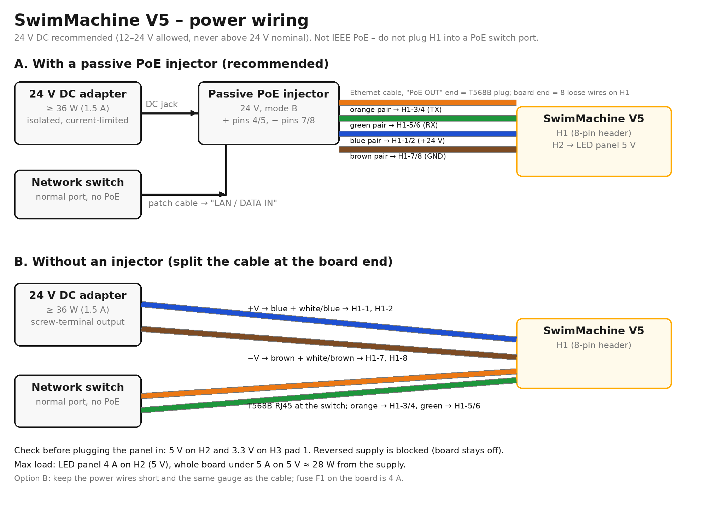

# SwimMachine V5 – Wiring & Power Guide

Hardware: `SwimMachineV5 final r3` (EasyEDA Pro, 2026-11-10) · ESP32-S3FH4R2 + W5500 · 65 × 55 mm

## Board overview

One 8-pin header (H1) carries both Ethernet and 12–24 V DC power. The LED panel gets 5 V from H2 and data from J1.


*PCB layout from the EasyEDA project, top view.*

| Connector | Where on the board | What it is for |
| --- | --- | --- |
| H1 – ETH / DC | Top right, 2 × 4 pins | Ethernet data + 12–24 V DC input, from one cable |
| H2 – +5V / GND | Bottom right, screw terminal | 5 V output to the LED panel, 4 A max |
| J1 – HUB75 3V3 | Centre, 2 × 8 socket | Data to the HUB75 LED panel |
| H3 – TC2030 | Left, pads (no connector fitted) | 3.3 V UART for flashing and logs |
| Antenna | Top left corner | 2.4 GHz Wi-Fi PCB antenna — keep metal and wires away |

## Ethernet + power cable (H1)

Wire the cable's far end as a standard **T568B** RJ45 plug. At the board end each of the 8 wires goes to its own H1 pin as below. Orange and green carry data, brown carries +12–24 V, and blue is ground. Note that this is the reverse of the most common passive-PoE injectors (+ on RJ45 pins 4/5, − on 7/8): use an injector or supply that puts + on the brown pair (pins 7/8) and − on the blue pair (pins 4/5).



| H1 pin | Signal | Wire colour (T568B) | RJ45 pin at far end |
| --- | --- | --- | --- |
| 1 | +12–24 V | Brown | 8 |
| 2 | +12–24 V | White/brown | 7 |
| 3 | TX+ | White/orange | 1 |
| 4 | TX− | Orange | 2 |
| 5 | RX+ | White/green | 3 |
| 6 | RX− | Green | 6 |
| 7 | GND | White/blue | 5 |
| 8 | GND | Blue | 4 |

- **Pin 1** is the square pad, bottom-left of the H1 block. Odd pins (1, 3, 5, 7) are the row nearer the board centre; even pins (2, 4, 6, 8) are the row at the board edge. The silkscreen reads +12–24V · TX+ TX− · RX+ RX− · GND GND.
- Keep each pair twisted right up to the header, so white/orange stays with orange and white/green with green.
- The board acts like a PC: it transmits on orange and receives on green. Plug the far end into a normal switch port or into the LAN/PoE port of a passive injector.
- If the far end is crimped **T568A** instead, the orange and green pairs swap: white/green goes to H1-3, green to H1-4, white/orange to H1-5 and orange to H1-6. Blue and brown stay the same.

## Power setup

Use an isolated, current-limited **24 V DC** supply of at least **36 W (1.5 A)**, fed into the cable's brown (+) and blue (−) pairs. H1 is **not IEEE 802.3af/at PoE**: a PoE switch will not power it, and the board has no PoE detection.



| Item | Value |
| --- | --- |
| Input voltage | 12–24 V DC; 24 V recommended |
| Absolute limit | Keep the supply at or below 24 V nominal: the SMBJ24A surge diode starts clamping at about 26.7 V |
| Input protection | 4 A fuse (F1), reverse-polarity MOSFET (Q1), surge diode (D2) |
| 5 V rail (AP64502) | Feeds the LED panel through H2: 4 A / 20 W max |
| 3.3 V rail (AP63203, from 5 V) | ESP32 + W5500: 1 A budget; 5 V panel + 3.3 V together must stay under 5 A |
| Input draw at full load | About 28 W: roughly 1.2 A at 24 V, or 2.4 A at 12 V |

**Why 24 V rather than 12 V:** the same power at half the current means a quarter of the voltage loss in the cable. At 12 V a full panel pulls about 2.4 A through four thin conductors, which is more than Ethernet cable is meant to carry and drops noticeably over a long run.

**Wiring the supply:** DC+ → brown pair (H1 pins 1 and 2), DC− → blue pair (H1 pins 7 and 8). With an injector, its data port goes to your switch. A standard injector (+ on blue) is reversed for this cable: Q1 blocks it so the board isn't damaged, but the board stays off.

**LED panel power:** run the panel's 5 V cable to the H2 screw terminal (+5V on the left, GND on the right as printed). Don't power the panel from a second supply at the same time.

## Other connectors

### J1 – HUB75 panel socket

The panel's data lines are driven at 3.3 V logic straight from the ESP32, so the panel must accept 3.3 V inputs. Pin numbers below are J1's own (pin 1 = square pad, bottom-left).

| J1 pin | Signal | ESP32 GPIO | J1 pin | Signal | ESP32 GPIO |
| --- | --- | --- | --- | --- | --- |
| 1 | OE | 48 | 2 | GND | – |
| 3 | CLK | 4 | 4 | LAT | 47 |
| 5 | C | 42 | 6 | D | 6 |
| 7 | A | 40 | 8 | B | 41 |
| 9 | B2 | 5 | 10 | E | 39 |
| 11 | R2 | 16 | 12 | G2 | 15 |
| 13 | B1 | 18 | 14 | GND | – |
| 15 | R1 | 21 | 16 | G1 | 17 |

J1 is numbered in the reverse pair order of a standard HUB75 header (R1/G1 sit at pins 15/16, not 1/2). That fits a socket that plugs straight onto the panel's pins; with a ribbon cable, check that R1 lands on the panel's pin 1.

**Panel colour order:** on the V5 panel, red and blue come out swapped relative to the J1 net names (a red/green/blue/white stripe test showed red as blue and blue as red; green was right). The V5 firmware compensates in software, so the GPIOs it actually drives are:

| Panel colour | Upper half (GPIO) | Lower half (GPIO) |
| --- | --- | --- |
| Red | 18 | 5 |
| Green | 21 | 16 |
| Blue | 17 | 15 |

If a different panel shows wrong colours, change only these six pins in `hub75.cpp` (the `SWIM_BOARD_V5` block).

### H2 – 5 V panel output

Two-way screw terminal: **+5V** (left) and **GND** (right), 4 A max.

### H3 – programming / UART (TC2030-IDC-NL pads)

| H3 pad | Signal | Connect to on a 3.3 V USB-UART adapter |
| --- | --- | --- |
| 1 | 3V3 | 3.3 V (only if the board is not powered from H1) |
| 2 | ESP TX | Adapter RX |
| 3 | ESP RX | Adapter TX |
| 4 | EN (reset) | RTS, or pulse to GND by hand |
| 5 | BOOT (GPIO0) | DTR, or hold to GND by hand |
| 6 | GND | GND |

To enter flashing mode without DTR/RTS wiring: hold pad 5 to GND, briefly short pad 4 to GND, then release pad 5. Serial runs at 115200 baud.

## Firmware for V5

V5 needs its own build: the ESP32-S3FH4R2 has **4 MB** in-package flash (the older board has 8 MB), 2 MB **quad** PSRAM, no USB wired (console on UART0 / H3), and different panel pins. `scripts/flash-linux.sh --board v5` handles all of it:

- compiles with `-DSWIM_BOARD_V5` (V5 panel pins in `hub75.cpp`) and FQBN `esp32:esp32:esp32s3:USBMode=hwcdc,CDCOnBoot=default,PSRAM=enabled,FlashSize=4M,FlashMode=qio,PartitionScheme=custom`;
- uses `partitions-v5.csv`: two 1.9 MB OTA app slots plus a 192 KB LittleFS (the app is about 1.25 MB);
- writes bootloader, partition table, app and the `data/` filesystem over H3.

```
scripts/flash-linux.sh --board v5 --port /dev/ttyACM9        # first flash over the UART adapter
scripts/flash-linux.sh --board v5 --build-only                # build only (for OTA)
python3 scripts/ota_upload.py --target <board IP> --bin build/arduino-v5/endless-pools-controller.ino.bin
```

**USB-UART adapter:** besides TX/RX, the adapter's RTS must reach H3 pad 4 (EN) and DTR pad 5 (BOOT), or esptool cannot enter download mode. Check it with RTS asserted: the chip must go silent (held in reset). If it keeps printing, EN is not connected. Without auto-reset, hold pad 5 to GND while resetting.

**Power while flashing:** the adapter's 3.3 V is enough to flash, but not for Wi-Fi: the board browns out as soon as Wi-Fi starts. Power it from H1 for normal use.

**After boot:** the board tries Ethernet first, then Wi-Fi from `data/wifi_config.json`, and falls back to its own access point `swimmachine` at 192.168.4.1. Later updates go over the network (OTA port 3232, password from `otapassword.h`).

## Before powering up

- [ ] H1 wired to the colour table above; each pair still twisted to the header
- [ ] Supply is passive DC (24 V recommended), not a PoE switch port
- [ ] Supply polarity checked: brown = +, blue = −
- [ ] First power-up without the panel: measure 5 V on H2 and 3.3 V on H3 pad 1
- [ ] Panel 5 V cable on H2 with correct polarity; no second supply connected to the panel
- [ ] HUB75 orientation checked: J1 pin 15 (R1) reaches the panel's R1
- [ ] Nothing metal near the antenna corner (top left)
